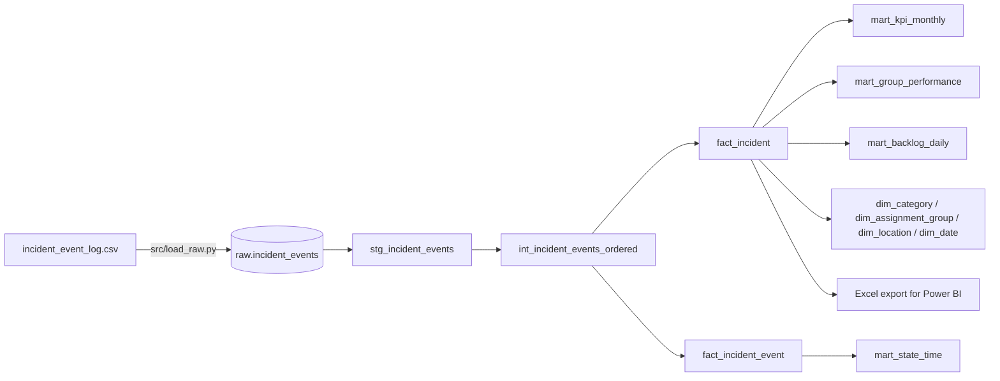
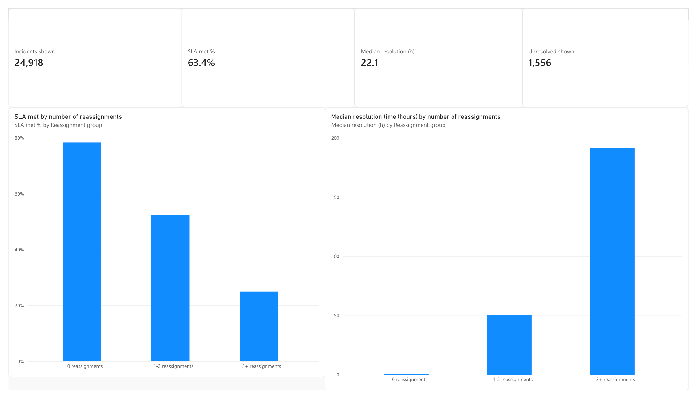
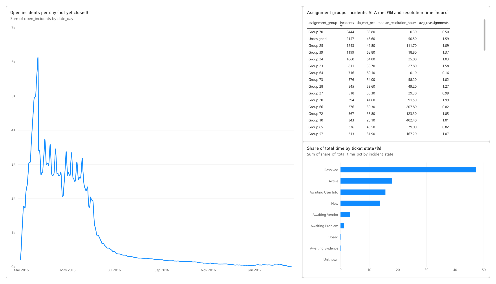

# ITSM incident analytics with dbt and PostgreSQL

A data pipeline on a **real ServiceNow incident log**: 141,712 events for 24,918 IT incidents. It loads the raw event log into PostgreSQL, cleans and models it with dbt (staging, a star schema and KPI tables), tests the result with 52 automated checks, and exports the tables for a Power BI report.

**Data:** [Incident management process enriched event log](https://archive.ics.uci.edu/dataset/498/incident+management+process+enriched+event+log), UCI Machine Learning Repository, licence CC BY 4.0. It was extracted from the audit system of a ServiceNow instance at an IT company, and personal data is anonymised.
Amaral, C., Fantinato, M., Peres, S. (2018). *Incident management process enriched event log.* https://doi.org/10.24432/C57S4H
The data file is not part of this repository. See [Run it](#run-it).

## What the pipeline does



| Layer | Model | What it does |
|---|---|---|
| Raw | `raw.incident_events` | The CSV as text, unchanged. Loaded by Python. |
| Staging | `stg_incident_events` | Real types, `?` turned into NULL, dates parsed, the invalid state `-100` renamed `Unknown` and flagged. |
| Intermediate | `int_incident_events_ordered` | Orders the events of each incident and looks at the next one (window functions). |
| Marts | `fact_incident` | One row per incident (24,918), from its last event. |
| | `fact_incident_event` | One row per event, with the hours spent in each state. |
| | `dim_*` | Date, category, assignment group, location. |
| | `mart_kpi_monthly`, `mart_state_time`, `mart_group_performance`, `mart_backlog_daily` | SLA and resolution time by month, time per state, group comparison, daily open backlog. |

## Tests

`dbt build` runs 12 models and 40 tests: **51 pass, 1 warning, 0 errors.**

- Generic tests: unique and not null keys, allowed values (states, priorities), relationships from the fact table to the dimensions.
- Custom tests: the incident and event counts must match the source, no incident may be resolved or closed before it was opened, and the open backlog must end at zero.
- The one warning is deliberate. In **5 events** of the real data, ServiceNow's change counter and the timestamps disagree about the order, which gives a negative time in state. I kept them and left the test as a warning so they stay visible.

## What the data shows

All figures come from the marts in this repository.

- **63.4% of the 24,918 incidents met their SLA** (the `made_sla` flag from ServiceNow).
- **Median resolution time is 22.1 hours, the mean is 178.2 hours.** A few very slow incidents pull the mean up, so medians are the better number here.
- **Reassignments go with slower, less successful tickets.** With no reassignment, 78.4% met the SLA and the median resolution was 0.7 hours. With 3 or more reassignments, 25.0% met it and the median was 191.8 hours. This is an association, not proof of cause.
- **One group does most of the work.** Group 70 handled 37.9% of incidents with 83.8% SLA success. Incidents without an assignment group (8.7%) met the SLA in 48.6% of cases.
- **Where the time goes.** 47.4% of all time between events is spent in the state *Resolved*. This is mostly waiting for the ticket to be closed, not work on it. *Active* is 18.0% and *Awaiting User Info* 15.7%.
- **Peak backlog:** 6,129 open incidents on 23 March 2016.

## Limits of the data

- **98.9% of incidents were opened between February and May 2016.** Later months have only 5 to 94 incidents, so monthly trends after May rest on very small numbers.
- **94.2% of incidents have the priority "3 - Moderate"**, so there is little to compare across priorities. Priority 1 and 2 are only about 2.7% of incidents.
- **All incidents in the log end as Closed.** There are no open tickets at the end of the log, so "backlog" means "not yet closed" at each day.
- **1,556 incidents (6.2%) were closed without ever being resolved.** Resolution time is only calculated for resolved incidents.
- `made_sla` is taken as given from ServiceNow. The SLA targets are not part of the data, so I could not recompute it.
- Five columns that are almost always empty (`caused_by`, `vendor`, `cmdb_ci`, `rfc`, `problem_id`) are left out of staging.
- The IDs for callers, groups and locations are anonymised ("Group 70"), so groups cannot be matched to real teams.

## Run it

You need Python 3.11 or newer, PostgreSQL, and about 50 MB of disk space.

```bash
git clone https://github.com/muskan688/itsm-incident-analytics.git
cd itsm-incident-analytics
python -m pip install -r requirements.txt
cp .env.example .env        # then set the database password
```

1. Download `incident_event_log.csv` from the [UCI page](https://archive.ics.uci.edu/dataset/498/incident+management+process+enriched+event+log) and put it in `data/raw/`.
2. Create an empty PostgreSQL database called `itsm_tickets`.
3. Run everything:

```bash
python src/run_pipeline.py       # load raw data, dbt build (models and tests), Excel export
python -m pytest                 # small unit tests
```

The pipeline can be run again at any time. The raw table is emptied and reloaded, and dbt rebuilds all models.

## Power BI report

Report file: [`powerbi/itsm_incident_report.pbix`](powerbi/itsm_incident_report.pbix), built on the Excel export of the marts. DAX is in [`powerbi/measures.dax`](powerbi/measures.dax).

**Page 1: SLA and resolution time.** Four KPI cards and two charts that show the main finding: the more reassignments an incident has, the less often it meets its SLA and the longer it takes.



**Page 2: backlog and where the time goes.** Open incidents per day, the time spent in each ticket state, and a table of assignment groups.



The figures on the report match the dbt tables: 24,918 incidents, 63.4% SLA met, median resolution 22.1 hours, 1,556 incidents closed without resolution.

## Project layout

```
src/        load_raw.py, run_pipeline.py, export_for_powerbi.py
dbt/        dbt project: models (staging, intermediate, marts), macros, tests
powerbi/    Power BI report, DAX measures and the Excel export of the marts
tests/      unit tests
```

## Next steps

- Process analysis of the state changes (most common paths, rework loops).
- SLA targets per priority, to recompute the SLA flag instead of using the one from ServiceNow.
